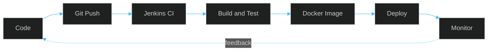

<!--
  ONLY EDIT THIS FILE. Everything in /assets and /.github is set up once and runs by itself.
  Profile repo: github.com/aniketjha348/aniketjha348
-->

  

  
  
  

  

  

<h2> About Me</h2>

I'm an **MCA student** who loves understanding how an application travels from a `git push` to production — **version control → automated tests → containers → deployment → monitoring → security**. My goal is to build deployment workflows that are **reliable, secure, and reproducible**.

> *Learning by building, documenting what works, and improving systems through automation.*

<table>
  <tr>
    <td width="25%" align="center" valign="top">
       
      <b>Learning</b> 
      Docker · Kubernetes · AWS · cloud-native deployment
    </td>
    <td width="25%" align="center" valign="top">
       
      <b>Working with</b> 
      Git · GitHub · Jenkins · Linux · Python · CI/CD
    </td>
    <td width="25%" align="center" valign="top">
       
      <b>Exploring next</b> 
      Terraform · Helm · GitOps · Prometheus · Grafana
    </td>
    <td width="25%" align="center" valign="top">
       
      <b>Goal</b> 
      Reliable, secure, reproducible deployments
    </td>
  </tr>
</table>

 

<h3> How I think about delivery</h3>

<h2> Tech Stack</h2>

| | |
|:---|:---|
| **Cloud** |  |
| **Containers** |  |
| **CI/CD & IaC** |  |
| **Languages & OS** |  |
| **Observability & Tools** |  |

Technologies reflect my learning and project interests — proficiency varies by tool.

<h2> Featured Projects</h2>

<table>
  <tr>
    <td width="50%" valign="top">
      
      <h3>Vele — CI/CD Pipeline</h3>
      
      
Repeatable pipeline for builds and deployments — source control, automated checks and Docker image creation, with documented stages and troubleshooting.

      
<code>Jenkins</code> <code>Docker</code> <code>GitHub</code> <code>TypeScript</code>

      <a href="https://github.com/aniketjha348/Vele-CI-CD"><b>View repository →</b></a>
    </td>
    <td width="50%" valign="top">
      
      <h3>Home Network Security Audit</h3>
      
      
Network enumeration and assessment methodology for an authorized environment — findings, remediation steps and security recommendations.

      
<code>Linux</code> <code>Nmap</code> <code>Network Security</code>

      <a href="https://github.com/aniketjha348/home-network-security-audit"><b>View repository →</b></a>
    </td>
  </tr>
  <tr>
    <td width="50%" valign="top">
      
      <h3>Cloud Infrastructure Automation</h3>
      
      
Reusable Terraform modules, environment separation and automated provisioning — with clear docs on networking, access controls and prerequisites.

      
<code>Terraform</code> <code>AWS</code> <code>Azure</code>

      <a href="https://github.com/aniketjha348?tab=repositories"><b>Explore repositories →</b></a>
    </td>
    <td width="50%" valign="top">
      
      <h3>Kubernetes Deployment Lab</h3>
      
      
Containerizing apps and practicing Kubernetes deployments, services and config management — exploring Helm releases and Prometheus/Grafana monitoring.

      
<code>Docker</code> <code>Kubernetes</code> <code>Helm</code> <code>Prometheus</code> <code>Grafana</code>

      <a href="https://github.com/aniketjha348?tab=repositories"><b>Explore repositories →</b></a>
    </td>
  </tr>
</table>

<h3> Live from GitHub</h3>

  
  

<h2> GitHub in 3D</h2>

  

  
  

  

  

  <picture>
    <source media="(prefers-color-scheme: dark)" srcset="https://raw.githubusercontent.com/aniketjha348/aniketjha348/output/github-snake-dark.svg"/>
    
  </picture>

<h2> Learning Roadmap</h2>

| Area | Focus | Progress |
|:---|:---|:---|
| **CI/CD** | Jenkins pipelines, automated testing, artifact management | 🟦🟦🟦⬛⬛ |
| **Containers** | Dockerfiles, image optimization, container security | 🟦🟦🟦⬛⬛ |
| **Cloud** | AWS fundamentals, IAM, VPC, EC2, networking | 🟦🟦⬛⬛⬛ |
| **Kubernetes** | Deployments, services, Helm, EKS fundamentals | 🟦🟦⬛⬛⬛ |
| **IaC & GitOps** | Terraform, Ansible, Argo CD | 🟦⬛⬛⬛⬛ |
| **Observability** | Prometheus, Grafana, centralized logging | 🟦⬛⬛⬛⬛ |
| **Security** | Linux hardening, secrets management, least privilege | 🟦🟦⬛⬛⬛ |

<h2> Professional Development</h2>

My learning path centers on **cloud, Linux administration, cybersecurity and infrastructure operations**:

- AWS cloud architecture and services
- Linux administration
- Azure cloud fundamentals and administration
- Cybersecurity and infrastructure security

<!-- Add earned certifications here only once their status is confirmed. -->

<h2 align="center"> Let's Connect</h2>

  Questions or ideas around <b>CI/CD, cloud or automation</b>? I'd love to hear from you.

  
  
  

<b>Build · Automate · Deploy · Observe · Improve</b>

  

