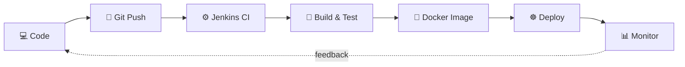

<!-- ═══════════════ HEADER ═══════════════ -->
<p align="center">
  
</p>

<p align="center">
  <a href="https://github.com/aniketjha348">
    
  </a>
</p>

<p align="center">
  <a href="https://github.com/aniketjha348"></a>
  <a href="https://linkedin.com/in/aniket-jha-devops"></a>
  <a href="mailto:aniketjha348@gmail.com"></a>
</p>

<p align="center">
  
  
  
  
</p>

---

## 👋 About Me

```text
┌──────────────────────────────────────────────────────────────┐
│  👨‍💻  Aniket Jha — MCA student & aspiring DevOps engineer     │
│  🎯  Focus     →  CI/CD · Cloud · Containers · Automation     │
│  📚  Learning  →  Docker · Kubernetes · AWS                   │
│  🧰  Working   →  Git · GitHub · Jenkins · Linux · Python     │
│  🔭  Next      →  Terraform · Helm · GitOps · Prometheus      │
└──────────────────────────────────────────────────────────────┘
```

I like understanding how an application travels from a `git push` to production — **version control → automated tests → containers → deployment → monitoring → security**. My goal is to build deployment workflows that are **reliable, secure, and reproducible**.

> 💡 *Learning by building, documenting what works, and improving systems through automation.*

<br/>

### 🔄 How I think about delivery



---

## 🛠️ Tech Stack

<div align="center">

| | |
|:---|:---|
| **☁️ Cloud** |  |
| **📦 Containers** |  |
| **🔁 CI/CD & IaC** |  |
| **💻 Languages & OS** |  |
| **📈 Observability & Tools** |  |

</div>

<sub>⚡ Technologies reflect my learning and project interests — proficiency varies by tool.</sub>

---

## 🚀 Featured Projects

<table>
  <tr>
    <td width="50%" valign="top">

### 🔧 Vele — CI/CD Pipeline


Repeatable pipeline for builds and deployments — source control, automated checks, and Docker image creation, with documented stages and troubleshooting.

**Stack:** `Jenkins` `Docker` `GitHub` `TypeScript`

[**View Repository →**](https://github.com/aniketjha348/Vele-CI-CD)

</td>
    <td width="50%" valign="top">

### 🛡️ Home Network Security Audit


Network enumeration and assessment methodology for an authorized environment — findings, remediation steps, and security recommendations.

**Stack:** `Linux` `Nmap` `Network Security`

[**View Repository →**](https://github.com/aniketjha348/home-network-security-audit)

</td>
  </tr>
  <tr>
    <td width="50%" valign="top">

### ☁️ Cloud Infrastructure Automation


Reusable Terraform modules, environment separation, and automated provisioning — with clear docs on networking, access controls, and prerequisites.

**Planned stack:** `Terraform` `AWS` `Azure`

[**Explore Repositories →**](https://github.com/aniketjha348?tab=repositories)

</td>
    <td width="50%" valign="top">

### ☸️ Kubernetes Deployment Lab


Containerizing apps and practicing Kubernetes deployments, services, and config management — exploring Helm releases and Prometheus/Grafana monitoring.

**Learning stack:** `Docker` `Kubernetes` `Helm` `Prometheus` `Grafana`

[**Explore Repositories →**](https://github.com/aniketjha348?tab=repositories)

</td>
  </tr>
</table>

---

## 📊 GitHub Analytics

<p align="center">
  
  
</p>

<p align="center">
  
</p>

<p align="center">
  
</p>

---

## 🧭 Learning Roadmap

| 🎯 Area | 📌 Focus | Progress |
|:---|:---|:---|
| **CI/CD** | Jenkins pipelines, automated testing, artifact management | 🟩🟩🟩⬜⬜ |
| **Containers** | Dockerfiles, image optimization, container security | 🟩🟩🟩⬜⬜ |
| **Cloud** | AWS fundamentals, IAM, VPC, EC2, networking | 🟩🟩⬜⬜⬜ |
| **Kubernetes** | Deployments, services, Helm, EKS fundamentals | 🟩🟩⬜⬜⬜ |
| **IaC & GitOps** | Terraform, Ansible, Argo CD | 🟩⬜⬜⬜⬜ |
| **Observability** | Prometheus, Grafana, centralized logging | 🟩⬜⬜⬜⬜ |
| **Security** | Linux hardening, secrets management, least privilege | 🟩🟩⬜⬜⬜ |

<sub>🟩 = done · ⬜ = ahead. Adjust the squares as you progress.</sub>

---

## 🎓 Professional Development

My learning path centers on **cloud, Linux administration, cybersecurity, and infrastructure operations**:

- ☁️ AWS cloud architecture and services
- 🐧 Linux administration
- 🔷 Azure cloud fundamentals and administration
- 🔐 Cybersecurity and infrastructure security

<!-- Add earned certifications here only once their status is confirmed. -->

---

## 💭 What Excites Me

- ⚙️ Building reliable CI/CD pipelines
- 🏗️ Automating infrastructure provisioning and configuration
- 🐳 Deploying and operating containerized applications
- 🔒 Improving infrastructure security and observability
- 🌐 Learning production-grade cloud architecture through real projects

---

<p align="center">
  <b>Build. Automate. Deploy. Observe. Improve.</b>
</p>

<p align="center">
  <a href="https://github.com/aniketjha348?tab=repositories"></a>
  <a href="https://linkedin.com/in/aniket-jha-devops"></a>
</p>

<p align="center">
  
</p>


